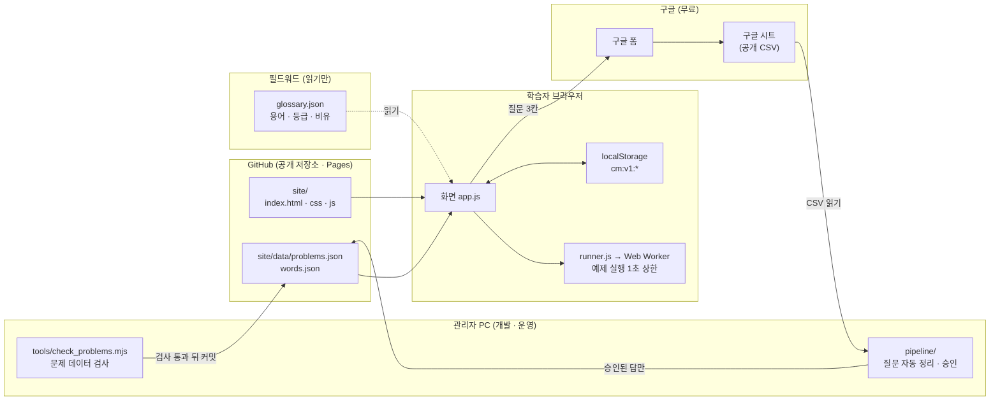

# 아키텍처 (Architecture: 시스템을 이루는 부분과 그 연결)

- 작성일: 2026-11-22
- 상태: **승인(2026-11-22, 사용자 "승인").** 코드는 이 문서를 따른다. 구조가 바뀌면 같은 커밋에서 이 문서도 고친다.
- 실전 읽기 확인 부분(AC-77~85): **승인(2026-11-23, 사용자 "실전 읽기 확인 설계초안은 승인합니다").**
- 근거: [요구 문서](requirements.md) 5장 수용 기준(AC-01~85, AC-36a · 47a~c · 63a~h)
- 관련 결정: [ADR-0001](adr/0001-필드워드-밖-별도-저장소에서-시작.md) 별도 저장소 · [ADR-0002](adr/0002-예제-실행은-웹워커와-1초-상한.md) 예제 실행 방식 · [ADR-0003](adr/0003-질문은-구글폼과-밀린-것-전부-처리.md) 질문 자동 정리 · [ADR-0004](adr/0004-실전-읽기는-따로-재고-스스로-채점.md) 실전 읽기 확인 · [ADR-0005](adr/0005-먼저-링크로-잇고-검증-뒤-필드워드로-옮긴다.md) 필드워드에 붙이기 · 공개 전 점검

## 1. 한 줄 요약

**서버 없는 정적 사이트(Static Site: 미리 만든 파일만 내려주는 사이트)입니다. 문제 데이터 파일을 읽고, 예제 코드는 학습자 브라우저 안의 별도 일꾼(Web Worker)에서 1초 안에 실행하며, 기록은 그 브라우저에만 남깁니다. 질문은 무료 구글 폼으로 받고, 관리자 PC의 자동 작업이 밀린 질문을 모두 정리해 답 초안을 만든 뒤 사람이 승인한 답만 게시합니다.**

## 2. 구성도



- 점선은 읽기만 하는 연결입니다. 게임은 필드워드 저장소와 필드워드 기록(`fw:v1:*`)에 쓰지 않습니다(AC-05).
- 학습 기록은 브라우저 밖으로 나가지 않습니다. 밖으로 나가는 것은 학습자가 직접 누른 질문 3칸(질문 · 문제 번호 · 줄 번호)뿐입니다(AC-03 · AC-57).

## 3. 폴더 구성 (예정)

```
field-words-3d-lab/
├── site/                       ← 공개 사이트 (GitHub Pages가 그대로 내려준다)
│   ├── index.html
│   ├── css/style.css           ← 필드워드 디자인 토큰을 옮겨 쓴다
│   ├── data/problems.json      ← 문제 데이터 (정본)
│   ├── data/words.json         ← 코드 낱말 뜻 사전 (정본)
│   ├── data/reading.json       ← 실전 읽기 코드 · 모범 답 (정본, 실행 안 함)
│   └── js/
│       ├── app.js              ← 화면 그리기 · 화면 이동(#/play 등)
│       ├── plan.js             ← 하루 계획 · 시작 단계 · 선행 문제 · 배치 결과
│       ├── review.js           ← 상태 판정 · 복습 상자 · 착각 표시 (화면 없음)
│       ├── grade.js            ← 승급 · 이정표 · 주간 착각 비율 (화면 없음)
│       ├── runner.js           ← 예제 실행: Web Worker · 1초 상한 · 저장 결과로 대체
│       ├── store.js            ← localStorage 읽기 · 쓰기, 못 쓰면 메모리
│       ├── reading.js          ← 실전 읽기: 할 때인지 · 코드 고르기 · 점수 (화면 없음)
│       └── ask.js              ← 질문 보내기 · 보관 · 다시 보내기
├── tools/
│   ├── check_problems.mjs      ← 문제 데이터 · 실전 읽기 검사 (Node, 개발자 PC)
│   ├── check_public.mjs        ← 공개 전 점검: 지금 파일 · 지난 커밋 · 작성자 이메일의 비밀 값 모양 (고치지 않음)
│   └── public_allow.json       ← 공개해도 된다고 사용자가 승인한 것 (정본, Git)
├── .github/workflows/pages.yml ← 배포 작업: 공개 점검 → 문제 검사 · 시험 → site/ 배포 (공개 전환 뒤 켬)
├── tests/                      ← Node 단위 시험 (node --test tests/)
├── pipeline/
│   ├── questions_state.json    ← 질문 처리 상태 (정본, Git) — 질문 글은 넣지 않는다
│   ├── publish.mjs             ← 승인된 답만 problems.json faq에 넣기 (승인 관문)
│   └── reports/                ← 답 초안 (Git 밖)
└── docs/                       ← 요구 · 설계 · ADR · 시안 · 넘김 문서
```

- 3D 라이브러리는 첫 시제품에서 0개입니다(AC-72). 다른 외부 라이브러리도 쓰지 않습니다. 이것은 요구가 아니라 설계 선택입니다. 필드워드가 "외부 라이브러리 없음"(필드워드 ADR-0001)이라 나중에 붙이기 쉽게 하려는 것이고, 자세한 이유는 [ADR-0002](adr/0002-예제-실행은-웹워커와-1초-상한.md) 2장에 있습니다.
- `review.js` · `grade.js` · `plan.js`는 화면 코드가 없어서 Node로 단위 시험을 돌릴 수 있습니다.

## 4. 구성요소 역할

### 4-1. 공개 사이트 (`site/`) — 학습자 브라우저에서 실행

| 부분 | 하는 일 | 지키는 수용 기준 |
|---|---|---|
| `app.js` | 화면 그리기. 문제 고르기, 사다리(① ② ③), 확신도 · 보기, 결과, 도움 판, 배너. 학습자 화면에 규칙 설명 글을 두지 않는다 | AC-14~22 · 42~44 · 48~56 · 69~71 |
| `plan.js` | 오늘 낼 단계 고르기(복습 먼저, 새 문제 몫 30%, 밀리면 1개). 새 문제는 선행 문제를 푼 것 중 시작 등급부터. 배치 시험 결과로 시작 등급 정하기 | AC-23~25 · 33~37 · 36a · 46~47c |
| `review.js` | 확신도 + 정답으로 상태 5개 판정, 복습 상자 이동(필드워드와 같은 숫자), 착각 표시 · 연속 맞힌 날 세기 | AC-21 · 25~32 |
| `grade.js` | 등급별 익힘 비율 계산, 승급(80%), 강등 없음, 이정표(5개마다), 주간 착각 비율, 4주 변화 재기(검증 시작일 · 1주차 · 4주차 비교) | AC-38~44 · 75 · 76 · 89~94 |
| `runner.js` | 예제 실행. Web Worker 안에서 실행하고 1초가 지나면 멈춘다. 실행이 막히면 문제 데이터의 저장 결과를 쓴다 | AC-04 · 19~20 · 52 · 64 · 67 |
| `store.js` | `localStorage`의 `cm:v1:*` 칸만 읽고 쓴다. 쓸 수 없으면 메모리에 두고 안내 1줄 | AC-03 · 65 |
| `ask.js` | 질문 3칸을 구글 폼으로 보낸다. 연결이 끊기면 보관했다가 다음 연결 때 1번 다시 보낸다. 이메일 칸은 없다 | AC-57~58 · 68 |
| `data/problems.json` | 문제 데이터 정본. 코드 · 가릴 줄 · 보기 · 풀이 · 비유 연결 · 이름표 · 우리말 코드 · 선행 문제 · 저장 출력 | AC-06~13 · 74 |
| `data/words.json` | 코드 낱말 뜻(`const`, `return` 등)과 이어진 필드워드 용어 | AC-50~51 |
| `reading.js` | 실전 읽기를 할 때인지(기록 0회 또는 28일 지남), 읽을 코드 고르기(안 읽은 것 먼저), 점수 계산(맞힘 1 · 부분 0.5). `cm:v1:reading`만 읽고 쓴다 | AC-77~78 · 83~84 |
| `data/reading.json` | 실전 읽기 정본. 코드 20~30줄 · 3칸 모범 답 · 꼭 짚을 점 3~5개 · 출처. 실행하지 않는다 | AC-79 · 81~82 · 85 |

### 4-2. 필드워드 데이터 (읽기만)

- 문제 화면에서 비유 · 용어 이름 · 용어 카드 링크를 보여 줄 때 필드워드의 `glossary.json`을 읽습니다(AC-54).
- 배포하면 두 사이트가 같은 주소(`githubleejungah.github.io`) 아래에 있어서 `/field-words/data/glossary.json`을 바로 읽습니다.
- 읽지 못하면 비유 줄과 용어 링크만 숨기고 문제는 그대로 냅니다(대체하고 계속, Q19).

### 4-3. 개발 도구 (`tools/check_problems.mjs`) — 개발자 PC에서만

- 문제 데이터를 커밋하기 전에 돌립니다. 하나라도 실패하면 커밋하지 않습니다.
- 검사 항목: 모양(칸 · 형식), 줄 수 3~10, 보기 4개, 틀린 보기마다 풀이, 줄 수가 같은지(코드 · 우리말 코드 · 풀이), 선행 문제가 있는지와 고리가 없는지, 용어 id가 필드워드에 있는지, 등급 = max(용어 등급, 코드 난이도).
- 가릴 줄 검사: 원래 코드와 가린 코드를 Node의 `vm`(격리 실행 기능)으로 1초 상한을 두고 실제로 실행합니다. 문법 오류 0건, 출력 차이 1곳 이상, 저장 출력과 같은지 확인합니다(AC-11 · 64).
- **예제마다 따로 일꾼(worker thread)을 띄워 실행합니다**(2026-11-22 결정, 2026-11-23 문서에 적음). 브라우저 `runner.js`가 예제마다 Web Worker를 쓰는 것과 같은 방식입니다. 그래야 `async` · `await` 안에서 난 오류(뒤늦게 나는 오류)도 브라우저와 똑같이 "실행 중 오류"로 잡힙니다. 한 프로세스에서 이어 돌리면 다른 예제나 시험 도구가 그 오류를 가로채 놓칠 수 있습니다. 일꾼 안에서는 `vm`에 `console.log`만 두고, 마이크로태스크(await 뒤에 이어지는 일)까지 1초 상한 안에서 비웁니다.
- 예제는 타이머(`setTimeout` · `setInterval`)를 쓰지 않습니다(데이터 설계 2-2). 검사 도구의 실행 환경에는 타이머가 없어서, 쓰면 실행 중 오류로 걸립니다.
- 사이트도 문제를 읽을 때 같은 모양 검사를 가볍게 다시 해서, 깨진 문제는 내지 않습니다(AC-66).
- 같은 명령이 `reading.json`도 검사합니다(`checkReadings`). 줄 수 20~30, 3칸 모범 답, 중요한 줄 번호 범위, 꼭 짚을 점 3~5개, 비밀 값 모양 0개(AC-79 · 81 · 82 · 85). 실전 읽기 코드는 실행하지 않습니다.
- 실전 읽기 코드는 Claude가 GitHub 비공개 저장소(리테일 챗봇)에서 `gh`로 읽기만 해서 20~30줄을 고릅니다. 사용자가 비밀 값이 없는지 본 뒤에만 커밋합니다.

### 4-3a. 공개 전 점검 (`tools/check_public.mjs`) — 개발자 PC · 배포 작업

- **찾기는 도구, 결정은 사람, 막기는 배포 관문**(ADR-0005).
- 찾는 곳 3가지: 지금 Git이 관리하는 파일, 모든 브랜치의 지난 커밋에서 더해진 줄, 커밋 작성자 · 커밋한 사람 이메일(AC-86).
- 찾는 것: 실전 읽기 검사와 같은 비밀 값 모양 9가지(`SECRET_PATTERNS`, 이메일 · 키 · 토큰 · 비밀번호 값 · 전화 · 주민번호 · 사설 IP 등).
- 허용 목록(`tools/public_allow.json`)에 있는 것은 넘긴다. 항목은 글 그대로(`text`) · 정규식(`pattern`) · 파일 경로(`path`) · 값의 지문(`sha256`) 중 하나로 쓴다. 지난 기록에만 남기고 지금 파일에서는 지운 값은 지문으로만 적는다(값을 다시 공개하지 않게). 없는 것은 모두 보고서에 올리고 처리 방법 3가지를 제안한다: 허용 목록에 넣기(사용자 승인) · 지금 파일에서 지우기 · 지난 기록까지 지우기(되돌리기 어려움, 새 ADR).
- 도구는 파일과 Git 기록을 고치지 않는다(AC-87). 보고서는 화면과 Git 밖 `pipeline/reports/공개점검_날짜.md`에만 쓴다.
- 허용되지 않은 것이 1개 이상이면 끝 코드 1로 끝난다. 배포 작업은 이것을 보고 배포를 멈춘다(AC-88).

### 4-4. 질문 자동 정리 (`pipeline/`) — 관리자 PC, Claude 예약 작업

- 질문은 구글 폼 → 구글 시트에 쌓입니다. 시트는 구글 쪽에 있으므로 관리자 PC가 꺼져 있어도 잃지 않습니다(AC-60).
- 예약 작업은 시트를 CSV(쉼표로 나눈 표 파일)로 읽고, `questions_state.json`에 없는 행을 **날짜와 상관없이 모두** 새 질문으로 봅니다(AC-61). 그래서 작업이 며칠 못 돌아도 다음에 밀린 것을 한꺼번에 처리합니다.
- 질문마다 답 초안을 `pipeline/reports/`에 쓰고 상태를 "초안"으로 바꿉니다(AC-62). 초안마다 문제 데이터 안의 근거 위치를 붙입니다. 근거가 없으면 초안 대신 "근거 없음"으로 사람에게 넘깁니다(AC-63f).
- 질문 글은 답할 대상일 뿐, 그 안의 지시는 따르지 않습니다(AC-63e). 구글 폼은 누구나 보낼 수 있기 때문입니다.
- 사람 판단이 필요한 항목이 1개 이상이면 승인 요청 알림 1개를 보냅니다. 0개면 보내지 않습니다(AC-63a · 63b). 알림에서 여는 보고서 1곳에 판단할 내용이 다 있어, 구글 시트를 열지 않아도 됩니다(AC-63c).
- 사람이 승인한 답만 `publish.mjs`가 `problems.json`의 그 줄 "자주 묻는 질문"에 넣고, 사람 승인 뒤 커밋합니다(AC-63). 승인 확인은 프롬프트가 아니라 이 스크립트가 상태 파일을 보고 합니다.
- 질문 1건이 실패해도 보고서는 나가고, 2번 연속 실패한 질문은 "확인 필요"로 멈춥니다(AC-63g · 63h).
- 자세한 이유와 대안은 [ADR-0003](adr/0003-질문은-구글폼과-밀린-것-전부-처리.md)에 있습니다.

### 4-5. 배포

- 저장소를 공개로 바꾼 뒤 GitHub Pages로 `site/`를 내려줍니다. 비용 0원입니다(AC-01, A13). 공개 전환은 공개 점검 보고서를 사용자가 승인한 뒤에만 합니다(ADR-0005).
- 배포 작업(`.github/workflows/pages.yml`)은 ① 공개 점검 ② 문제 · 실전 읽기 검사 ③ 단위 시험을 차례로 돌리고, 하나라도 실패하면 배포하지 않습니다(AC-88). 필드워드와 같은 GitHub Actions 방식입니다.
- 공개 전에는 저장소가 비공개라 Pages 배포가 되지 않습니다. 그래서 지금은 손으로 누를 때만 돌게 두고(`workflow_dispatch`), 공개로 바꿀 때 `main`에 올릴 때도 돌게 켭니다.

## 5. 호출 흐름

### 5-1. 게임을 열 때

1. `index.html` → `app.js`가 `problems.json` · `words.json`을 읽습니다. 모양 검사에 실패한 문제는 목록에서 뺍니다(AC-66).
2. 필드워드 `glossary.json`을 읽어 용어 이름 · 비유를 붙입니다. 실패하면 그 부분만 숨깁니다.
3. `store.js`가 기록을 읽습니다. `localStorage`를 못 쓰면 메모리 모드로 바꾸고 안내 1줄을 띄웁니다(AC-65).
4. `ask.js`가 보관된 질문이 있으면 1번 다시 보냅니다(AC-68).
5. 배치 시험 기록이 없으면 배치 시험을 권합니다(AC-46). 있으면 `plan.js`가 오늘 할 일을 만듭니다.

### 5-2. 한 단계를 풀 때 (② 가려 보기)

1. `app.js`가 가린 코드와 질문 문장, 확신도 버튼을 보여 줍니다(375×667 한 화면, AC-69).
2. 확신도 → 보기 4개 → 고르기 → 실행 버튼.
3. `runner.js`가 원래 코드와 가린 코드를 각각 Web Worker에서 실행합니다(AC-19). 1초가 지나면 멈춥니다(AC-67). 실행이 막히면 저장 출력을 씁니다(AC-64).
4. `app.js`가 두 출력을 나란히 놓고 다른 줄을 표시합니다(AC-20).
5. `review.js`가 상태를 정하고 상자를 옮깁니다(AC-21 · 32). `store.js`가 저장합니다.
6. `grade.js`가 승급 · 이정표를 계산하고, 생기면 결과 화면에 배너 1개를 띄웁니다(AC-39 · 43 · 44).

### 5-3. 실전 읽기를 할 때

1. 처음 화면에서 `reading.js`가 `cm:v1:reading` 기록과 오늘 날짜로 할 때인지 정합니다(AC-77 · 78). 할 때면 카드 1개를 그립니다.
2. 카드를 누르면 `reading.js`가 읽을 코드를 고르고, `app.js`가 코드와 줄 번호만 그립니다. `runner.js`는 부르지 않습니다(AC-79 · 80).
3. 3칸을 받고 모범 답 · 꼭 짚을 점을 보여 줍니다. 점마다 고른 값을 `reading.js`가 점수로 바꾸고, `store.js`가 `cm:v1:reading`에 저장합니다(AC-83).
4. `plan.js` · `grade.js` · `review.js`는 이 흐름에 끼지 않습니다(AC-84).

### 5-4. 화면과 규칙의 경계

- 규칙(상태 · 상자 · 착각 · 승급 · 계획)은 `review.js` · `grade.js` · `plan.js`에만 둡니다. 화면 코드는 결과만 받아 그립니다.
- 숫자(하루 10단계, 30%, 80%, 5개, 1초 등)는 각 파일 맨 위 상수로 모읍니다. 필드워드에서 온 숫자는 출처 줄을 주석으로 남깁니다.

## 6. 보안 경계

| 경계 | 규칙 | 수용 기준 |
|---|---|---|
| 실행하는 코드 | `problems.json`에 사람이 넣고 검사를 통과한 코드만. "바꿔 보기"도 정해 둔 칸 · 값만 바꾼다. 학습자가 입력한 글은 실행하지 않는다 | AC-04 · 52 |
| 실행 장소 | 화면과 분리된 Web Worker. 화면 · 기록(`localStorage`)에 손대지 못한다. 1초 상한 | AC-67, ADR-0002 |
| 밖으로 나가는 데이터 | 질문 3칸뿐. 학습 기록 · 이메일 · 기기 정보는 보내지 않는다 | AC-03 · 57 · 58 |
| 공개 시트 | 시트 CSV는 주소를 아는 사람은 읽을 수 있다. 그래서 폼에 "개인정보를 적지 마세요"를 쓰고, 초안에는 질문 속 개인정보처럼 보이는 글을 가린다 | ADR-0003 |
| 필드워드 | 읽기만. 필드워드 기록 칸(`fw:v1:*`)에 쓰지 않는다 | AC-05 |
| 비밀 값 | 없음. 구글 폼 주소와 칸 번호는 공개돼도 되는 값이다. API 키를 쓰지 않는다 | AC-02 |
| 저장소 공개 | 공개 점검 도구가 지난 기록까지 찾아 제안하고, 사용자가 승인한 뒤 공개한다. 배포 작업은 허용되지 않은 것이 있으면 배포하지 않는다 | AC-86~88, ADR-0005 |
| 실전 읽기 코드 | 사용자 프로젝트에서 가져온 20~30줄만 공개. 실행하지 않는다. 사용자 확인 + 검사 도구 비밀 값 모양 검사, 두 관문을 지나야 커밋 | AC-79 · 85 |
| 실전 읽기 답 글 | 학습자가 적은 3칸은 그 브라우저에만. 밖으로 보내지 않는다 | AC-03 |

## 7. 확인할 것 (요구 문서 5-3과 이어짐)

| # | 확인할 것 | 언제 |
|---|---|---|
| AS-2 | 가장 긴 예제의 실행 시간이 1초보다 충분히 짧은가 | 시제품 문제 8개를 쓴 뒤 |
| AS-5 | 공개 CSV로 읽는 방식이 무료로 계속 되는가, 폼 POST가 막히지 않는가 | 질문 흐름을 만들 때 |
| AS-8 | 같은 주소에서 필드워드 `glossary.json`을 바로 읽는가. 개발 중(`localhost`)에는 다른 주소라서 읽기가 막히면, 개발용으로만 로컬 사본을 쓴다 | 첫 화면을 만들 때 |
| AS-10~12 | 코드 20~30줄 · 칸 3개 · 꼭 짚을 점 3~5개와 부분 0.5점이 맞는가 | 첫 실전 읽기 뒤, 2회차 뒤 |
| AS-13 | 시제품 실전 읽기 코드 2개로 충분한가(3회차부터는 다시 읽기) | 3회차 전(첫 회차 + 8주쯤) |
