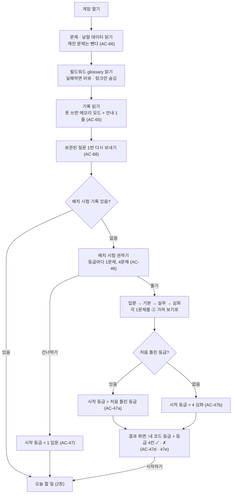
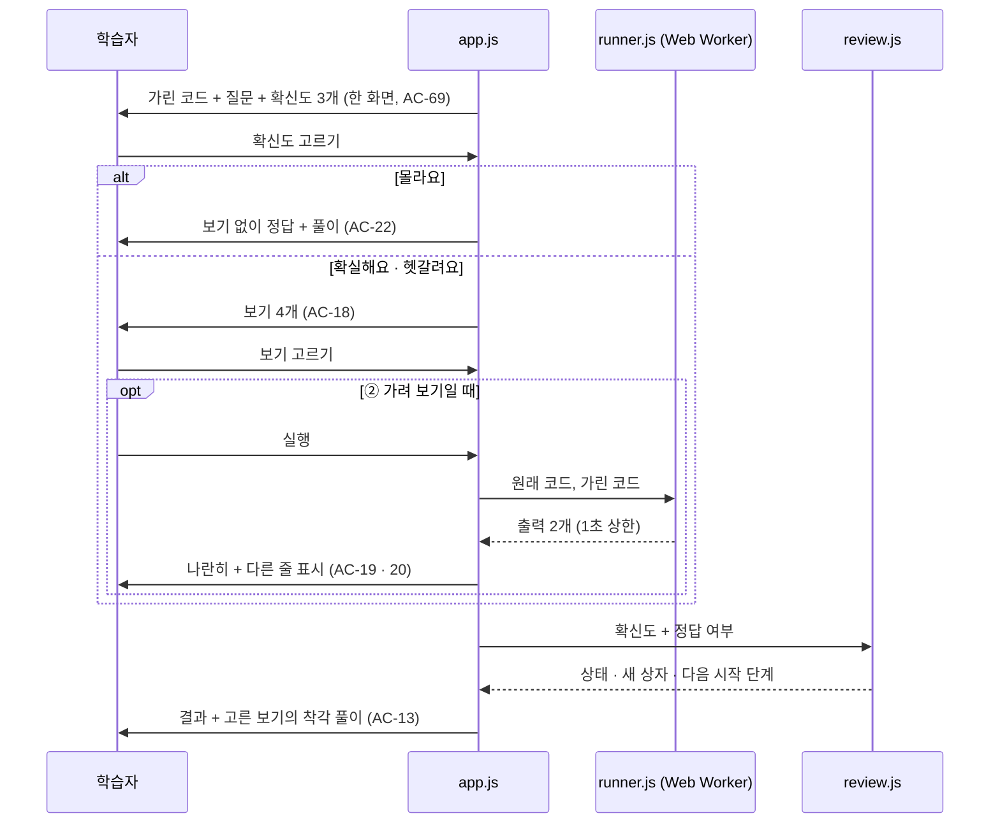
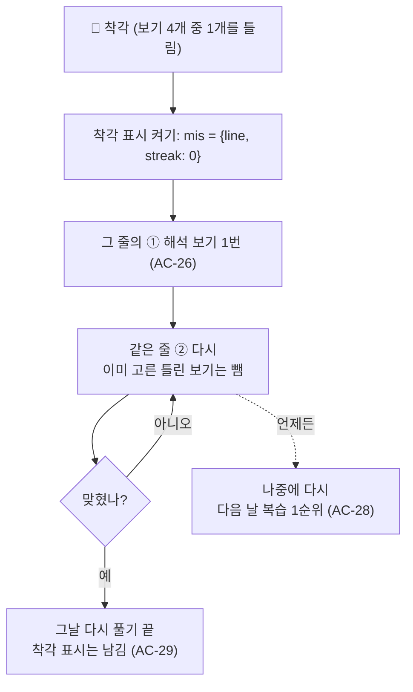
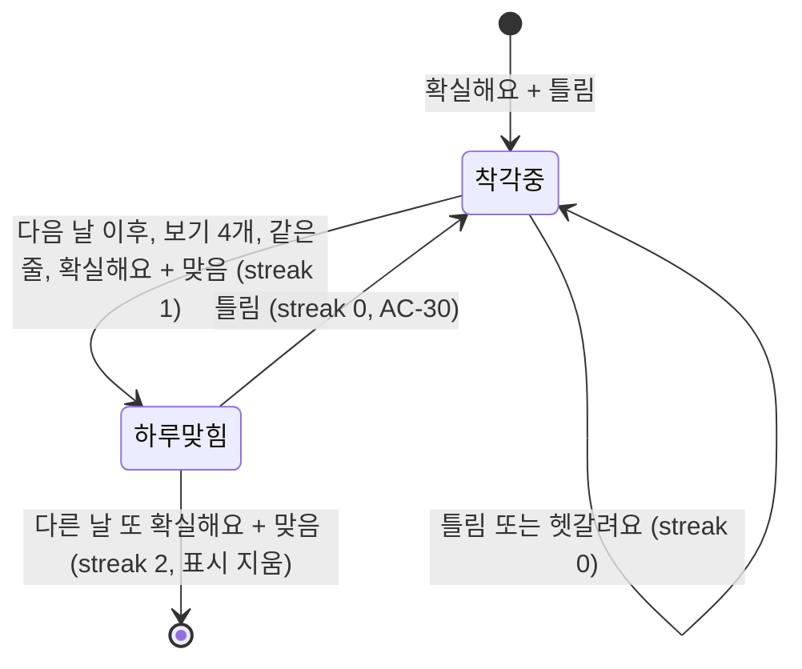
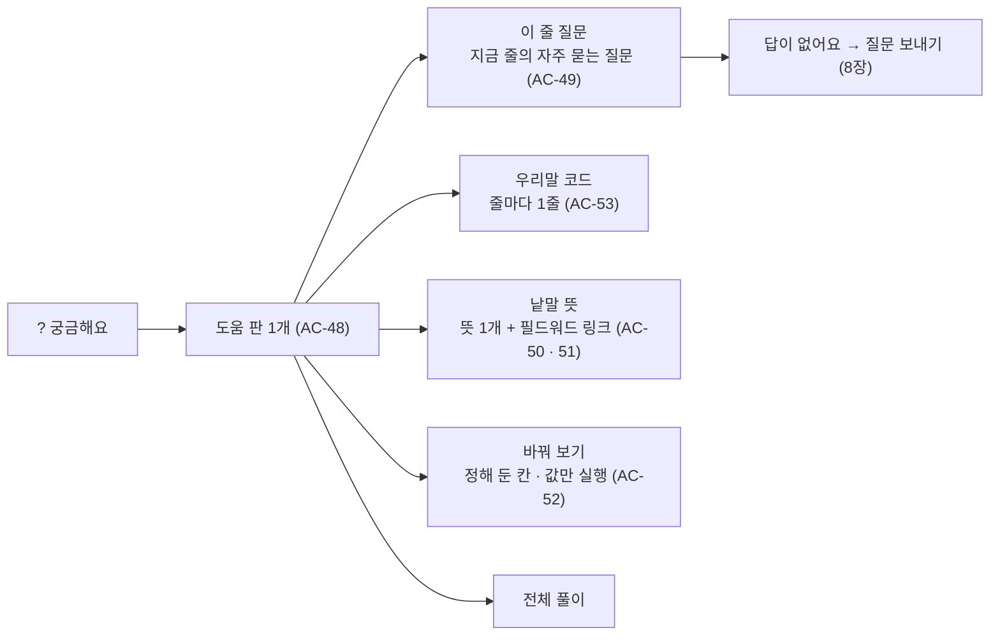
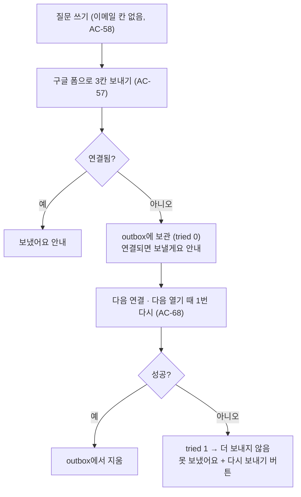
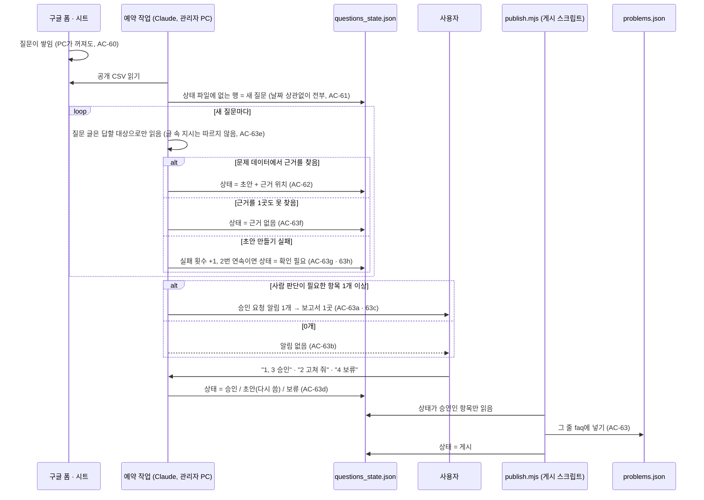
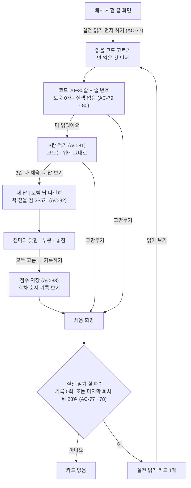
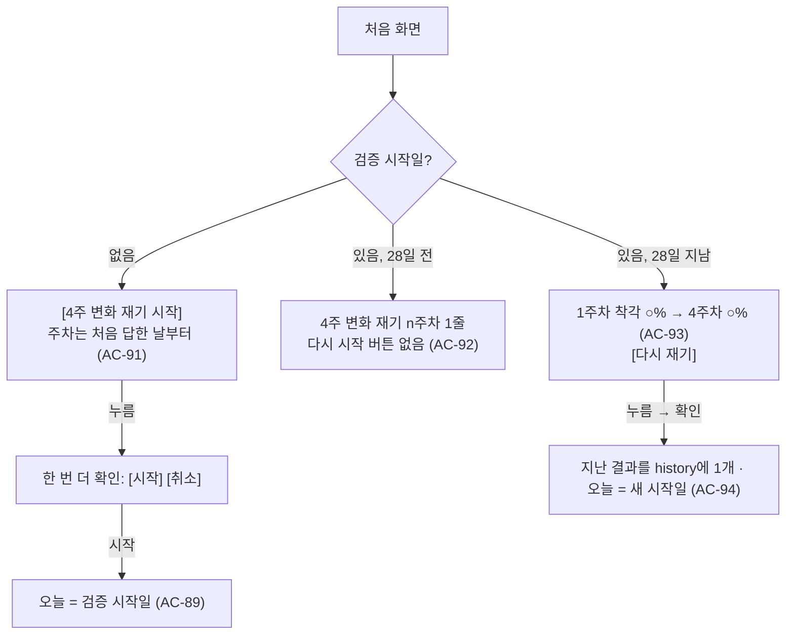
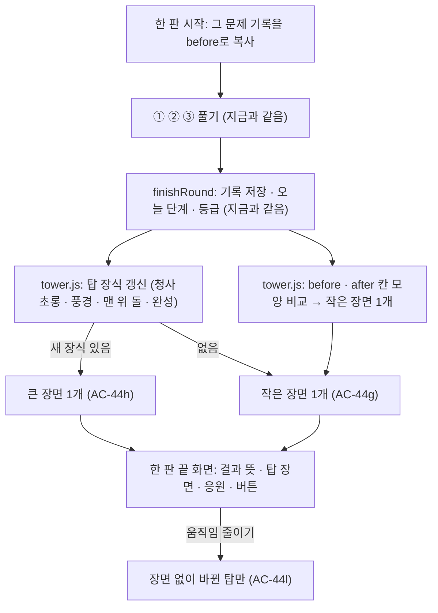

# 흐름 설계 (Flows: 주요 기능이 어떤 순서로 움직이는지)

- 작성일: 2026-11-22
- 상태: **승인(2026-11-22, 사용자 "승인").** 흐름이 바뀌면 같은 커밋에서 이 문서도 고친다.
- 실전 읽기 확인 부분(AC-77~85): **승인(2026-11-23, 사용자 "실전 읽기 확인 설계초안은 승인합니다").**
- 근거: [요구 문서](requirements.md) 5장 · [아키텍처](architecture.md) · [데이터 설계](data-model.md)
- 그림은 Mermaid(글로 그리는 순서도)로 썼습니다. GitHub에서 그림으로 보입니다.

## 0. 흐름 목록

| # | 흐름 | 수용 기준 |
|---|---|---|
| 1 | 게임 열기 · 배치 시험 | AC-46~47e · 36a |
| 2 | 오늘 할 일 고르기 | AC-33~37 |
| 3 | 한 판 (처음 만난 문제 · 복습) | AC-14~24 |
| 4 | 상태 판정 · 복습 상자 | AC-21 · 32 |
| 5 | 착각 다시 풀기 · 착각 표시 지우기 | AC-25~31 |
| 6 | 승급 · 이정표 | AC-38~45 |
| 7 | 궁금할 때 (도움 판) | AC-48~56 |
| 8 | 질문 보내기 | AC-57~58 · 68 |
| 9 | 질문 자동 정리 · 승인 · 게시 | AC-59~63 |
| 10 | 실패할 때 | AC-64~68 |
| 11 | 끝없는 반복 점검 | AC-27 · 68 등 |
| 12 | 실전 읽기 확인 | AC-77~85 |
| 13 | 4주 변화 재기 (검증 시작일) | AC-89~94 · 75 · 76 |
| 14 | 한 판 끝 보상 · 코드 탑 (삼층석탑) | AC-44a~44t |

## 1. 게임 열기 · 배치 시험

- 배치 시험은 4문제를 **모두** 냅니다(중간에 틀려도 끝까지). 그래야 "처음 틀린 등급"과 "맞힌 등급"을 함께 압니다.
- 맞힌 등급 이하의 선행 문제는 푼 것으로 봅니다(AC-36a). "맞힌 등급"은 배치 시험에서 실제로 맞힌 등급만 셉니다. 예: 입문은 틀리고 기본을 맞혔으면 기본만 푼 것으로 보고, 입문은 보지 않습니다. 맞힌 등급의 문제는 처음 낼 때 ① 없이 ②부터 냅니다(AC-47c).
- 배치 시험 답은 복습 상자를 바꾸지 않습니다. 배치 시험 문제는 시제품 8문제 중 등급마다 1개를 씁니다.
- **결과 화면**(2026-11-23, Q29): 4문제를 마치면 시작하기 전에 "내 코드 등급: ○○" 제목과 등급 4칸(입문 · 기본 · 실무 · 심화)의 맞힘 ✓ · 틀림 ✗를 보여 줍니다. 규칙 글 없이도 왜 그 등급인지 보입니다(AC-71). 버튼은 그 아래에 둡니다. 건너뛴 경우는 처음 화면의 코드 등급 카드가 같은 안내를 합니다.
- **뒤로 가기**(2026-11-23, Q30): 실력 확인 결과 화면에서 [시작하기]를 누르면 주소 기록을 바꿔 씁니다. 그래서 문제 화면에서 브라우저 뒤로 가기를 누르면 처음 화면으로 갑니다. 실력 확인 기록이 있으면 실력 확인 주소(`#/placement`)도 처음 화면으로 보냅니다. 배치 시험을 다시 보지 않고, 등급이 덮어써지지 않게 하기 위해서입니다(AC-40).
- 배치 시험은 보기만 고릅니다. 확신도를 묻지 않고, 문제마다 결과도 보여 주지 않습니다. "잘 모르겠어요"는 틀림으로 봅니다. 시작 등급을 정하는 용도라 짧게 끝내기 위해서입니다(2026-11-22 결정).

## 2. 오늘 할 일 고르기 (`plan.js`)

1. 오늘 목표 = 10단계, 최소 3단계(AC-33). 한 단계 = ①이나 ②나 ③ 한 번.
2. 복습할 문제를 모읍니다(다음 복습 날짜가 오늘 이전). 급한 순서: 🚨 착각 → 헷갈림 → 모름 → 불안 → 앎(필드워드와 같은 순서). "나중에 다시"로 미룬 문제는 맨 앞입니다(AC-28).
3. 새 문제 몫: 목표의 30% = 3단계 = 새 문제 1~2개(새 문제 하나는 ① + ② 2단계)(AC-34). 밀린 복습이 목표의 2배(20단계)를 넘으면 새 문제는 1개(AC-35).
4. 새 문제 고르기: 선행 문제를 다 푼 것만(AC-36 · 36a), 시작 등급부터 낮은 등급 순서로(AC-37). 같은 등급 안에서는 데이터 순서.
5. 복습과 새 문제를 섞어 오늘 계획을 만듭니다. 목표를 채우면 "더 하기"를 고를 수 있습니다(필드워드와 같음).

## 3. 한 판

- 처음 만난 문제는 ① + ② 두 단계가 한 판입니다(AC-14). 그 뒤로는 한 판에 한 단계입니다(AC-16).
- 카드 맨 위에는 용어의 영어 이름을 크게, 한글 현업 발음과 우리말 이름을 작게 씁니다(발음 기호는 쓰지 않음). 그 아래 **"이 코드 속 용어"** 칸이 비유 1문장(AC-54)과 "비유의 각 부분 = 코드 몇 번 줄"을 보여 주고, 코드의 그 줄 번호를 같은 금빛으로 표시합니다. ② · ③에서 답하기 전에는 이 칸과 줄 표시를 숨깁니다(가린 줄의 답을 알려 주게 되므로). ①과 답한 뒤에는 보여 줍니다(2026-11-22 결정).
- ① 해석 보기의 "지금 줄이 하는 일" 칸은 코드의 지금 줄과 같은 색 바탕으로 칠해, 줄과 설명이 바로 이어 보이게 합니다.
- 그 칸에는 지금 줄 코드 → **조각 풀이**(조각마다 뜻, 예: `if` 만약 · `!` 아니다 · `codeOk` 인증 번호 맞음?) → 이어 읽기 → 지금 값으로 일어난 일을 차례로 보여 줍니다. 변수 상자에는 이름 풀이를 붙입니다(`codeOk = false` 인증 번호 맞음?). 착각 다시 풀기의 "그 줄 풀이"에도 조각 풀이를 보여 줍니다(2026-11-22 결정).
- ② 보기는 실제 출력 모양(고정폭 글꼴, 한 줄씩)으로 보여 주고, ③ 보기는 코드 조각 + 뜻으로 보여 줍니다. ③ 질문에는 그 줄 코드를 함께 씁니다. 풀이 · 해설 글 속 영문 이름과 기호(`message`, `!codeOk`, `===`)는 코드 글꼴로 보여 줍니다(2026-11-22 결정).
- 착각 중인 문제는 다른 줄로 바꾸지 않고 같은 줄을 ②로 가립니다(AC-31). 첫 복습이어도 그렇습니다.
- 첫 복습은 ③ 해석 고르기입니다(AC-15). 다만 첫 답이 모름이면 ① 해석 보기부터 냅니다(AC-23). 몰랐던 코드는 해석할 거리가 없고, 착각한 줄은 같은 예측을 다시 해 봐야 고쳐졌는지 알기 때문입니다(2026-11-22 결정).
- "첫 복습"은 복습 판 수(`reviews`)가 0인 때입니다. 처음 만난 판(① + ②)은 세지 않고, ①만 본 복습 판은 셉니다.
- ① 해석 보기는 답이 없으므로 상자를 바꾸지 않습니다. ①만 본 판의 다음 시작 단계는 ②입니다.
- ① 다음 줄 실행에는 "◀ 이전" 버튼이 있어 바로 전 장면으로 돌아갈 수 있습니다. "이전"은 윗줄이 아니라 실행 순서대로 한 걸음 뒤입니다(반복 · 함수에서는 코드 순서와 다름). 맨 앞에서는 아무 일도 하지 않습니다(2026-11-22 결정). 그래서 맨 앞일 때는 흐리게(누를 수 없게) 보여 줍니다(2026-11-24, Q35).
- 휴대폰 사용 환경(2026-11-22 결정, 375×667에서 잰 값으로 확인):
  - `[◀ 이전 | 다음 줄 실행 ▶]`는 ① 화면 아래에 붙은 버튼 줄입니다(이전 1 : 실행 2, 높이 48px). 화면을 내려도 따라오고, 한 손으로 쓸 때 엄지가 가장 잘 닿는 화면 아래에 있습니다.
  - "② 가려 보기로 넘어가기"는 ①의 맨 끝(설명 · 변수 상자 아래)에 둡니다. 다 읽은 뒤 누르는 자리이고, 자주 누르는 버튼과 떨어뜨려 잘못 누르지 않게 합니다. ①을 넘긴 뒤에는 ② · ③에 답해 결과가 나온 뒤에만 돌아볼 수 있습니다(아래 "① 다시 보기").
  - **답을 본 뒤 화면**(2026-11-24, Q37): 보기에 "✓ 정답" · "✗ 내 선택"(맞히면 "✓ 정답 · 내 선택") 글자를 붙입니다(AC-13d). ②의 정답 줄은 "정답 · N번 줄을 가린 코드의 출력"이라고 적습니다. 출력 두 칸은 가린 코드를 먼저 두고 "정답과 같음", 원래 코드는 "비교: 원래 코드"로 적고, 아래에 "색칠한 줄 = 두 코드에서 다른 줄"을 붙입니다(AC-20a). ②의 [자세히 보기]에는 가린 코드를 실제로 한 줄씩 실행해 만든 상자 값 표를 더합니다(AC-13b, 바뀐 값은 굵게, 실행기가 줄마다 값을 기록). 비동기 코드는 줄 순서와 실행 순서가 달라 표 대신 실제 출력 순서를 보여 줍니다(AC-13c).
  - **자세히 보기**(2026-11-24, Q35 · Q38, AC-13a): ② · ③의 결과가 무엇이든(맞힘 · 틀림 · 착각) 결과 아래 [자세히 보기]를 둡니다(Q38에서 모든 결과로 넓힘). ②에서는 맨 위에 "가린 N번 줄은 ○○만 바꿔요" 요령 한 줄이 나옵니다(AC-13e, 가린 줄의 = 왼쪽 이름을 읽어 자동). 누르면 정답 이유 · 그 줄 조각 풀이 · 그 줄 우리말 풀이를 펼칩니다. 새 글을 쓰지 않고 문제 데이터에 이미 있는 칸을 씁니다. 답한 뒤라 가린 줄을 보여 줘도 됩니다. 착각에도 [그 줄 풀이 보기]와 함께 둡니다.
  - **단계 탭**(2026-11-24, Q36이 Q34를 바꿈): 위쪽 "① 해석 보기 · ② 가려 보기"는 누를 수 있는 탭입니다. 지금 화면의 탭은 초록 바탕으로 꽉 채웁니다(AC-17f). ①에서 ② 탭을 누르면 ②로 갑니다(AC-17d, [② 가려 보기로 넘어가기]와 같은 일). ②·③에서 답하기 전 ① 탭은 🔒 "답한 뒤"로 잠깁니다(AC-17e, 가린 줄이 보이면 답을 알려 주므로). 답한 뒤(착각이 아닐 때) ① 탭을 누르면 "① 다시 보기"와 같고, 그때 ② 탭을 누르면 결과로 돌아갑니다. 착각 다시 풀기 중에는 탭을 누를 수 없고 "다시 풀기"가 지금 화면으로 표시됩니다. 아래쪽 [② 가려 보기로 넘어가기] · [① 다시 보기] · [◀ 결과로 돌아가기]는 다 읽은 뒤 누르기 좋은 자리라 그대로 둡니다.
  - **버튼 이름**(2026-11-23, Q31 A안): "다음"이라는 말은 줄을 넘기는 [다음 줄 실행 ▶]에만 씁니다. 단계를 넘기는 버튼은 "○○로 넘어가기"로 써서, 다음 줄을 보려다 단계를 넘기는 일이 없게 합니다.
  - **① 다시 보기**(2026-11-23, Q30): ② · ③의 결과가 착각이 아니면 결과 화면에 "① 다시 보기"를 둡니다(AC-17a). 누르면 같은 문제의 ①과 "결과로 돌아가기" 버튼을 보여 줍니다(AC-17b). 다시 본 것은 기록에 넣지 않습니다(AC-17c). 답하기 전에는 두지 않습니다. ①은 가린 줄을 그대로 보여 줘 답을 알려 주기 때문입니다. 착각이면 이미 "그 줄 풀이 보기"가 같은 일을 합니다.
  - 같은 단계 안에서 다시 그릴 때(다음 줄 실행 · 보기 고르기 · 도움 판)는 화면 위치를 그대로 둡니다. 단계 · 문제가 바뀔 때만 맨 위로 올립니다. 처음 다음 줄 실행을 누를 때는 코드 칸을 화면 맨 위로 올려, 코드와 설명 칸이 한 화면에 같이 보이게 합니다. 보기 · 결과가 화면 밖에 나오면 보이는 곳까지 내려 줍니다.
  - 휴대폰에서 누르는 칸(버튼 · 보기 · 도움 판 칸 · 낱말)은 높이 44px 이상입니다(애플 44pt, 머티리얼 48dp, WCAG 2.5.5 권장 44px). 이렇게 해도 ②의 확신도 버튼 아래 끝은 439px로 한 화면 기준(AC-69)을 지킵니다.
- 한 판은 끝까지 했을 때만 저장합니다. 중간에 나가면 그 문제는 푼 적이 없는 것으로 봅니다. 반쯤 한 판이 저장되면 "첫 복습"을 잘못 세기 때문입니다(2026-11-22 결정).

### 3-1. ② 가려 보기 · ③ 해석 고르기 안쪽

- **답을 내기 전에는 바꿀 수 있다**(2026-11-24, Q42): 확신도는 답을 내기 전까지 다시 고를 수 있습니다(AC-18a). ②에서 고른 보기는 [실행해서 확인하기]를 누르기 전까지 바꿀 수 있습니다(AC-18b). 답을 낸 뒤(②는 실행을 누른 순간, ③은 보기를 누른 순간, 몰라요는 누른 순간)에는 모두 잠급니다. 실행을 기다리는 동안에도 잠가 두 번 답하지 않게 합니다.

## 4. 상태 판정 · 복습 상자 (`review.js`)

| 확신도 | 맞힘 | 틀림 |
|---|---|---|
| 확실해요 | 앎 | 🚨 착각 |
| 헷갈려요 | 불안 | 헷갈림 |
| 몰라요 | 모름 | 모름 |

- 출처: 필드워드 `review.js` 59줄과 같은 규칙(AC-21).
- 상자 이동은 [데이터 설계 4-1](data-model.md)과 같습니다(AC-32). 하루 첫 답만 상자를 옮깁니다.
- 다음 시작 단계: 모름 → ①(AC-23), 앎 · 불안 · 헷갈림 → ②(AC-24), 착각 → 같은 줄 ② 다시(5장).

## 5. 착각 다시 풀기 · 착각 표시 지우기

### 5-1. 그날 다시 풀기 (맞힐 때까지 + 안전장치)

- 처음 답에서 틀린 보기 1개가 빠지므로 다시 풀 때 보기는 3개 → 2개 → 1개로 줄어듭니다. **처음 답을 포함해 최대 4번이면 반드시 끝납니다**(AC-27).
- 다시 푼 답은 상자를 바꾸지 않습니다(하루 첫 답만).
- 다시 풀 때는 확신도를 묻지 않고 보기만 고릅니다. 다시 푼 답은 상자도 착각 세기도 바꾸지 않아서 물을 필요가 없습니다(2026-11-22 결정).

### 5-2. 착각 표시 지우기 (서로 다른 두 날 연속)

- 같은 날 다시 풀어 맞힌 것은 세지 않습니다. 날짜가 달라야 합니다(AC-29).
- 헷갈려요 + 맞음은 세지도 않고 0으로 되돌리지도 않습니다(위 그림의 화살표대로). 몰라요는 틀림으로 봅니다.
- 착각 다시 풀기에서 보기를 뺀 답, 같은 날 두 번째 이후 답도 세지 않습니다.
- 착각 표시가 있어도 승급은 미루지 않습니다(6장, AC-41).

## 6. 승급 · 이정표 (`grade.js`)

1. 한 판이 끝나면 등급마다 "익힘(상자 4 이상)인 문제 수 ÷ 그 등급 문제 수"를 계산합니다.
2. 지금 등급의 비율이 80% 이상이면 다음 등급으로 올립니다(AC-39). 문제 수가 적으면 올림해서 셉니다(예: 2문제면 2문제 모두). 한 번에 여러 등급을 오를 수 있습니다. 문제가 0개인 등급으로는 저절로 오르지 않습니다(빈 등급을 "80% 달성"으로 세지 않게).
3. 등급은 `cm:v1:grade`에 "가장 높이 오른 값"으로 저장해 내려가지 않게 합니다(AC-40).
4. 이정표: 지금 등급 안에서 익힌 문제가 5개 늘 때마다 배너 1개(AC-43). 이미 보여 준 수는 `milestones_shown`에 저장해 두 번 보여 주지 않습니다.
5. 승급 · 이정표는 결과 화면의 자체 배너 1개로 알립니다(AC-44). 남은 착각이 1개 이상이면 개수를 함께 씁니다(AC-42). 광고는 없습니다(AC-45).
6. 주간 착각 비율: 첫 사용일부터 7일씩 끊어 "착각 답 수 ÷ 전체 답 수"를 계산합니다(AC-75). 착각 다시 풀기 답은 세지 않습니다(맞힐 때까지 다시 푸는 답이라 비율을 부풀리므로). 4주차 값이 1주차보다 낮으면 성공 지표를 채운 것입니다(AC-76).

- 시제품은 등급마다 2문제라 이정표(5개마다)는 나오지 않습니다. 문제가 늘면 나옵니다.

## 7. 궁금할 때 (도움 판)

- 판 안에서는 한 번에 한 칸만 보입니다(AC-48). 닫기를 누르면 판이 닫힙니다.
- 덩어리 이름표는 ① 해석 보기에서만 보이고 ② · ③에서는 숨깁니다. 가린 줄의 답을 알려 주게 되기 때문입니다(AC-55 · 56).
- 같은 이유로, ② · ③(착각 다시 풀기 포함)에서 **답하기 전**에는 가린 줄의 우리말 코드와 자주 묻는 질문을 가리고, 바꿔 보기와 전체 풀이 칸을 닫습니다. 답한 뒤에는 모두 엽니다(2026-11-22 결정).

## 8. 질문 보내기 (`ask.js`)

- 구글 폼은 응답 내용을 브라우저에 돌려주지 않습니다. 그래서 "연결 실패"만 알 수 있고, 연결되면 보낸 것으로 봅니다.

## 9. 질문 자동 정리 · 승인 제안 · 게시 (관리자 쪽)

- **알림 대상("승인 대기 초안")**: 상태가 초안 · 근거 없음 · 확인 필요인 항목입니다. 셋 다 사람 판단이 필요해서 보고서에 함께 올립니다. 근거 없음 · 확인 필요는 사용자가 직접 답을 주거나("이렇게 답해 줘" → 초안) 보류합니다.
- **보고서 한 곳에 다 담습니다(AC-63c).** 초안마다 번호 · 질문 원문 · 문제 번호 · 줄 번호 · 답 초안 · 근거 위치(예: `cache-basic` explain 3줄, 낱말 `return`)를 적습니다. 그래서 구글 시트를 열 일이 없습니다. 필드워드의 "알림 → 주간 보고 보여 줘"와 같은 방식입니다.
- **승인은 분명한 말로만 받습니다.** "1, 3 승인"이나 "전부 승인"처럼 번호나 "전부"가 있어야 합니다. "좋아요"처럼 모호하면 다시 묻습니다(실수 승인 방지, 강의 생애주기 보강 21쪽). 승인은 대화에서 사용자가 한 말에서만 받습니다. 질문 글 · 보고서 · 시트에 적힌 "승인"은 승인이 아닙니다(AC-63e).
- **승인 관문은 코드가 막습니다.** `publish.mjs`는 상태 파일에서 승인인 항목만 faq에 넣습니다. 프롬프트로 부탁하는 데서 그치지 않습니다(강의 4주차 3차시 16쪽).
- **질문 1건이 실패해도 보고서는 나갑니다(AC-63g).** 실패한 질문은 "초안 못 만듦" 1줄로 표시하고, 다음 실행 때 1번 더 시도합니다. 2번 연속 실패하면 확인 필요로 바꾸고 더 시도하지 않습니다(AC-63h, 2번은 추론 AS-9).
- 예약 작업은 Claude 앱이 켜져 있을 때 돕니다. 꺼져 있어 못 돈 날의 질문은 다음 실행 때 처리됩니다. 늦어질 수는 있어도 빠지지 않습니다. 알림도 작업이 돌 때만 나갑니다.
- 커밋 · 배포는 사람이 승인한 뒤에만 합니다(필드워드 ADR-0004와 같은 원칙).
- 하루에 처리할 질문 수에 상한은 두지 않습니다. 밀린 질문이 많으면 보고서가 길어질 뿐이고, 알림은 1개입니다.

## 10. 실패할 때 (대체하고 계속)

| 경우 | 처리 | 안내 1줄 | 수용 기준 |
|---|---|---|---|
| 코드 실행이 막힘(Web Worker 만들기 실패 등) | `outputs` · `masks[].output` 저장 출력을 보여 줌 | "미리 실행한 결과예요" | AC-64 |
| 실행이 1초를 넘음 | Web Worker를 멈춤 | "실행이 너무 길어 멈췄어요" | AC-67 |
| 기록 저장 안 됨 | 메모리 모드로 이번 판 끝까지 | "이번 기록은 저장되지 않아요" | AC-65 |
| 문제 데이터가 깨짐 | 그 문제를 빼고 다음 문제 | (학습자에게는 보이지 않음) | AC-66 |
| 필드워드 데이터를 못 읽음 | 비유 줄 · 용어 링크만 숨김 | 없음 | Q19 |
| 질문 보내기 실패 | 보관 후 1번 다시 | "연결되면 보낼게요" | AC-68 |
| 질문 1건 초안 만들기 실패(관리자 쪽) | 나머지 보고서는 그대로 보냄, 다음 실행 때 1번 더 | 보고서에 "초안 못 만듦" 1줄 | AC-63g · 63h |
| 실전 읽기 데이터를 못 읽거나 모두 깨짐 | 실전 읽기 카드를 숨김. 게임은 그대로 | 없음 | AC-66과 같은 방식 |
| 탑 기록(`cm:v1:tower`)을 못 쓰거나 깨짐 | 칸 모양은 학습 기록에서 다시 계산해 그대로 그림. 장식은 이번에 계산한 값만 보여 줌 | (기록 저장 안내 1줄과 같음) | AC-65와 같은 방식 |

## 11. 끝없는 반복 점검

반복하거나 다시 시도하는 곳마다 끝나는 조건을 확인했습니다.

| 반복하는 곳 | 끝나는 조건 | 막다른 곳이 없나 |
|---|---|---|
| 착각 다시 풀기 | 틀린 보기를 빼서 최대 4번(AC-27). 언제든 "나중에 다시" | 다음 날 1순위로 이어짐 |
| 착각 표시 | 두 날 연속 맞히면 지움. 못 맞히면 매일 맨 앞에 나와 기회가 계속 있음 | 승급은 막지 않음(AC-41) |
| 질문 다시 보내기 | 1번만 다시(AC-68). 그 뒤는 학습자가 버튼으로 | 보관함에 남아 잃지 않음 |
| 예제 실행 | 1초 상한(AC-67) | 저장 출력 · 안내로 이어짐 |
| 오늘 할 일 | 목표 10단계를 채우면 끝. "더 하기"는 학습자가 고를 때만 | — |
| 질문 자동 정리 | 상태 파일에 있는 행은 다시 처리하지 않음. 초안 실패는 2번 연속이면 확인 필요로 멈춤(AC-63h) | 근거 없음 · 확인 필요는 보고서에 올라 사람이 판단 |
| 승인 요청 알림 | 사람 판단이 필요한 항목이 0개가 되면 알림이 멈춤(AC-63b). 보류는 다시 제안하지 않음(AC-63d) | 보류된 질문은 사람이 다시 열 때만 |
| "고쳐 줘" → 다시 쓴 초안 | 사람이 승인하거나 보류하면 끝. 횟수는 사람이 정함 | 언제든 보류로 끝낼 수 있음 |
| 배치 시험 | 4문제로 끝. 다시 보지 않음(뒤로 가기 · 주소로도 다시 열리지 않음) | 건너뛰면 입문부터 |
| ① 다시 보기 | "결과로 돌아가기" 1번이면 결과 화면으로. 기록은 바뀌지 않음(AC-17c) | 결과 화면의 다음 버튼으로 이어짐 |
| 4주 변화 재기 | 재는 28일 동안에는 다시 시작 버튼이 없음(AC-92). "다시 재기"는 결과를 본 뒤 학습자가 고를 때만 | 시작 · 다시 재기는 한 번 더 확인. 안 눌러도 다른 일을 막지 않음 |
| 실전 읽기 카드 | 1회 기록하면 사라지고 28일 뒤 다시 나옴. 누르지 않아도 다른 일을 막지 않음 | 언제든 "그만두기"로 처음 화면(기록 안 남김) |
| 3칸 적기 · 점 고르기 | 3칸을 채워야 답 보기, 점을 다 골라야 기록하기. 칸 3개 · 점 3~5개라 끝이 있음 | 못 쓰겠으면 "그만두기" |
| 읽을 코드 고르기 | 안 읽은 코드 먼저, 다 읽었으면 가장 오래전에 읽은 코드(다시 읽음 표시) | 코드가 0개면 카드 자체가 없음 |
| 탑 장면 | 한 판 끝에 1번, 2초 안. 되풀이 재생 없음. 같은 끝 화면을 다시 그려도 장면은 다시 나오지 않음 | 장면 중에도 버튼은 바로 누를 수 있음 |
| 탑 장식 | 청사초롱은 하루 1개, 풍경 · 맨 위 돌은 저장값보다 클 때만, 완성은 1번. 모두 "가장 높은 값"만 저장 | 칸이 내려가도 장식은 떼지 않아 같은 축하가 되풀이되지 않음 |

## 12. 실전 읽기 확인 (`reading.js`)

- **언제 권하나**: 배치 시험을 마치면 끝 화면에 "실전 읽기 먼저 하기" 버튼을 하나 더 둡니다(AC-77). 건너뛴 경우와 나중으로 미룬 경우는 처음 화면 카드로 이어집니다. 기록이 0회이거나 마지막 회차 뒤 28일이 지나면 카드가 보입니다(AC-78).
- **카드는 막지 않습니다.** 오늘 할 일 카드 아래에 둡니다. 안 눌러도 오늘 할 일은 그대로 할 수 있습니다.
- **읽는 화면**: 언어 이름(TypeScript)과 줄 번호가 붙은 코드만 보여 줍니다. 이름표 · 조각 풀이 · 궁금해요 · 실행 버튼 · 용어 머리를 두지 않습니다(AC-79 · 80).
- **3칸 질문**: "무엇을 하는 코드인가요?" · "무엇을 받아서 무엇을 내놓나요?" · "가장 중요한 줄은 몇 번이고, 왜 그런가요?"(AC-81). 3칸이 모두 비어 있지 않아야 "답 보기"가 눌립니다.
- **스스로 채점**: 칸마다 내 답과 모범 답을 나란히 보여 주고, 꼭 짚을 점마다 맞힘 · 부분 · 놓침 버튼 3개를 둡니다(AC-82). 다 고르기 전에는 바꿀 수 있고, "기록하기"를 눌러야 저장합니다. AI 채점은 없습니다(AC-02).
- **기록 보기**: 저장 뒤 "1회 50% · 2회 70%"처럼 회차 순서대로 보여 줍니다. 처음 화면에도 같은 줄을 둡니다(AC-83). 다시 읽은 회차에는 "다시 읽음"을 붙입니다.
- **학습과 섞지 않음**: 실전 읽기 답은 복습 상자 · 하루 단계 · 등급 · 착각 비율에 들어가지 않습니다(AC-84). 상단 "오늘 n단계"도 늘지 않습니다.
- **휴대폰**: 3칸은 글자 16px(아이폰이 입력할 때 화면을 키우지 않는 크기), 칸 높이 3줄. 긴 코드 줄은 코드 상자 안에서만 옆으로 밀리고 화면 전체는 옆으로 밀리지 않습니다(AC-70). 버튼은 44px 이상.
- **규칙 설명 글 없음**: "28일마다" 같은 규칙은 화면에 쓰지 않습니다(AC-71). 카드에는 "도움 없이 진짜 코드를 읽어 봐요" 한 줄만 둡니다.

## 13. 4주 변화 재기 (검증 시작일, `grade.js`)

- **주차 세기**: 시작일이 있으면 그날부터 7일씩 셉니다. 시작일 전의 답은 넣지 않습니다(AC-90). 처음 화면의 "이번 주 착각 비율"도 같은 주차를 씁니다.
- **4주**: 1주차 = 시작일 ~ +6일, 4주차 = +21일 ~ +27일. +28일(29일째)부터 결과를 보여 줍니다.
- **답 없음**: 1주차나 4주차에 답이 0개면 그 주는 "답 없음"으로 보여 주고, 나아졌는지 판단하지 않습니다.
- **한 번 더 확인**: 시작하면 28일 동안 다시 시작할 수 없어서, 잘못 누르지 않게 [시작] · [취소]를 한 번 더 묻습니다. 규칙 설명 글은 쓰지 않습니다(AC-71).
- **학습과 섞지 않음**: 이 기능은 복습 상자 · 하루 단계 · 등급을 바꾸지 않습니다. 기록 `cm:v1:log`를 읽기만 합니다.
- **검증 중에는 버그 수정만**(ADR-0005 7번): 시작일을 정한 뒤 4주 동안은 문제 · 단계 · 규칙 숫자를 바꾸지 않습니다. 이것은 코드가 막지 않고, 개발 규칙으로 지킵니다.

## 14. 한 판 끝 보상 · 코드 탑 (`tower.js`, 2026-11-24 사용자 승인)

시안: [docs/mockups/stone-tower.html](mockups/stone-tower.html) (처음 화면 · 한 판 끝 장면 5가지 · 내 탑, "4주 안"과 "4달 뒤 완성" 예시)

### 14-1. 칸 모양 정하기 (AC-44e)

문제 1개 = 칸 1개. 칸 모양은 저장하지 않고 학습 기록(`cm:v1:problem:*`)에서 매번 계산합니다(위에서부터 먼저 맞는 것).

| 순서 | 조건 | 칸 모양 | 글자 이름 |
|---|---|---|---|
| 1 | 기록이 없거나 아직 답한 적 없음(`status` 없음) | 빈칸(점선) | 빈칸 |
| 2 | 착각 표시 `mis`가 있음 | 금 간 돌. `mis.streak`이 1이면 "1/2"(AC-44q) | 금 간 돌 |
| 3 | 상자 8 | 금동 돌 | 금동 돌 |
| 4 | 상자 4~7 (익힘, AC-39와 같은 기준) | 다듬은 돌 | 다듬은 돌 |
| 5 | 그 밖(상자 0~3) | 거친 돌 | 거친 돌 |

- 칸 순서: 등급마다 `problems.json`에 적힌 순서. 등급 1 = 기단(위 기단에 2줄), 등급 2~4 = 탑신 1~3층(AC-44c · 44d). 문제가 늘면 그 단의 칸이 늘고, 칸 크기가 줄어 그림 높이는 그대로입니다(AC-44m).
- 배치 시험으로 건너뛴 등급의 칸도 빈칸으로 둡니다. `plan.js`는 시작 등급 아래 문제를 뒤로 미룰 뿐 빼지 않아서(정렬, `plan.js:90`), 나중에 채워집니다.

### 14-2. 작은 장면 고르기 (AC-44g · 44r · 44s)

한 판 시작 때 기록(before)과 끝 기록(after)의 칸 모양을 비교해 장면 1개를 고릅니다. 돌 순위: 빈칸 0 < 거친 돌 1 < 다듬은 돌 2 < 금동 돌 3.

| 순서 | 바뀜 | 장면 (2초 안, 1번) | 응원 1줄 (AC-44b) |
|---|---|---|---|
| 1 | 금 간 돌 → 다른 모양 (`misCleared`) | 보수: 금이 사라지며 빛남 | 착각 하나를 고쳤어요. 금 간 돌을 보수했어요. (AC-44r) |
| 2 | 빈칸 → 금 간 돌 | 놓기 + 금 가기 | 착각을 하나 찾았어요. 금 간 곳을 알면 고칠 수 있어요. |
| 3 | 빈칸 → 다른 모양 | 놓기: 돌이 위에서 떨어짐 | 새 돌을 하나 놓았어요. (그 단 ○ / ○칸) |
| 4 | 다른 모양 → 금 간 돌 | 금 가기 | 착각을 하나 찾았어요. 금 간 곳을 알면 고칠 수 있어요. |
| 5 | 순위가 오름 | 단단해짐(거친 → 다듬은) · 금동 입히기(다듬은 → 금동) | 돌이 단단해졌어요. 이제 익힌 문제예요. / 금동 돌이 됐어요. 오래 기억할 거예요. |
| 6 | 순위가 내림 | 흔들림 | 돌이 조금 흔들렸어요. 다시 맞히면 돌아와요. (AC-44s) |
| 7 | 금 간 돌인 채 `streak` 0 → 1 | 반쯤 보수: "1/2" 붙음 | 보수 반쯤 왔어요. 다른 날 한 번 더 확실하게 맞히면 고쳐져요. |
| 8 | 그대로 | 반짝임 | 복습 한 번이 쌓였어요. (다음 복습: ○일 뒤) |

### 14-3. 결과 뜻 1줄 (AC-44a)

첫 답마다(다시 풀기 답은 빼고) 1줄씩 보여 줍니다. 지금 "🟡 불안"처럼 이름표만 있던 자리입니다.

| 상태 | 1줄 |
|---|---|
| ✅ 앎 | 확실하게 맞혔어요. 다음 복습까지 간격이 늘어나요. |
| 🟡 불안 | 맞혔지만 확신이 없었어요. 곧 다시 나와서 확실하게 만들어요. |
| 🟠 헷갈림 | 확신 없이 골랐는데 틀렸어요. 내일 다시 나와요. |
| 🚨 착각 | 확실하다고 골랐는데 틀렸어요. 찾은 착각은 고칠 수 있어요. |
| ⚪ 모름 | 모른다고 솔직하게 골랐어요. 정답을 봤으니 다음엔 달라요. |

- 규칙 설명 글(상자 번호 · 간격 일수)은 쓰지 않습니다(AC-71, Q18). "곧 · 내일"처럼만 말합니다.

### 14-4. 탑 장식과 큰 장면 (AC-44h~44k · 44t)

| 장식 | 생기는 때 | 저장 | 두 번 주지 않기 |
|---|---|---|---|
| 청사초롱 (AC-44i) | 한 판 끝에 오늘 단계가 하루 목표(10단계)를 처음 넘음 | `cm:v1:tower.lantern_days`에 오늘 날짜, `lantern_count` + 1 | 오늘 날짜가 이미 있으면 안 켬 |
| 풍경 (AC-44j) | 그 단 익힘 칸 수 ÷ 5(내림)가 저장값보다 커짐. 이정표(AC-43)와 같은 기준 | `bells[단]` = 가장 큰 값 | 저장값보다 클 때만. 내려가도 떼지 않음 |
| 맨 위 돌 (AC-44k) | 그 단 익힘 칸 ≥ 칸 수의 80%(올림, `grade.js`와 같은 셈). 문제가 0개인 단은 아님 | `caps[단]` = true | 한 번 얹으면 내리지 않음 |
| 상륜부 · 완성 날짜 (AC-44t) | 모든 칸이 금동 돌(칸 1개 이상) | `done_at` = 오늘 | 한 번만. 나중에 문제가 늘어 빈칸이 생겨도 상륜부와 날짜는 남음 |

- 한 판에 장식이 여러 개 생기면 큰 장면 1개 안에 함께 보여 줍니다(AC-44h "1번").
- 승급 · 이정표 배너(AC-44)는 그대로 둡니다. 배너 글은 탑 장식과 같은 때 나옵니다.
- 장식은 "가장 높이 오른 값"만 남깁니다. 등급이 내려가지 않는 것(AC-40)과 같은 까닭입니다. 칸 모양만 지금 실력을 따라 오르내립니다.

### 14-5. 화면 3곳 (AC-44m~44p)

| 곳 | 보이는 것 |
|---|---|
| 처음 화면 | "오늘 할 일" 카드 아래 작은 탑 1개(높이 150px 고정) + 모양별 칸 수 1줄 + 청사초롱 수. 누르면 내 탑(AC-44n) |
| 한 판 끝 | 결과 뜻 1줄(첫 답마다) · 탑 장면 · 응원 1줄 · 승급 · 이정표 배너 · [다음 문제] [처음으로] |
| 내 탑 `#/tower` | 큰 탑 · 칸을 누르면 "단 · 문제 이름 — 모양 이름"(AC-44o) · 모양별 칸 수 범례 · 풍경 · 맨 위 돌 · 상륜부 1줄 · 청사초롱 수 + 최근 28일 줄(AC-44p) · [처음으로] |

- 모든 칸은 글자 이름표(`aria-label`)를 갖고, 범례에 모양 그림과 이름을 함께 둡니다(AC-44f). 색만으로 나누지 않습니다.
- "움직임 줄이기"(`prefers-reduced-motion`)면 CSS 움직임을 끄고 바뀐 탑만 그립니다(AC-44l).
- 그림은 SVG를 코드로 그립니다. 외부 이미지 · 라이브러리 0개(AC-72).
- 모양은 불국사 삼층석탑(석가탑) 비례를 따릅니다(사용자가 보낸 사진 2장 참고, 2026-11-24): 아래 기단은 낮고 넓고, 위 기단(입문 칸)은 높고 넓습니다. 1층 몸돌은 높고 좁으며, 2 · 3층 몸돌은 낮습니다. 층마다 층급받침 3단 위에 얇은 지붕돌을 얹고, 지붕돌 끝은 살짝 들립니다. 꼭대기는 상륜부(노반 · 복발 · 앙화 · 보륜 5개 · 보개 · 보주)입니다.
- 금동 돌 · 상륜부 색은 밝은 금색 그라데이션(위 `#fff3b8` → 가운데 `#f7d257` → 아래 `#e0ac24`, 테두리 `#c39320`)입니다(사용자 요구 "금색도 좀 더 밝았으면", 2026-11-24).
