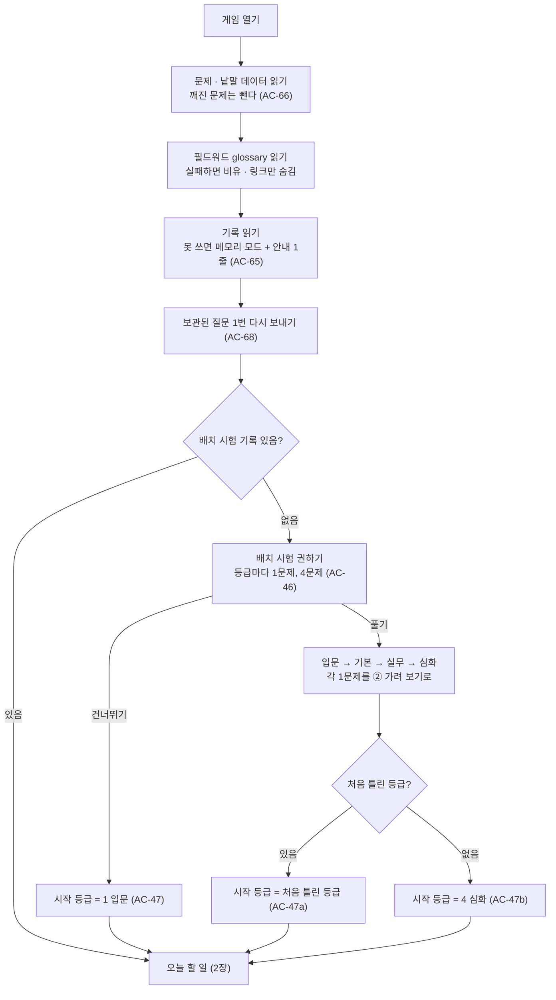
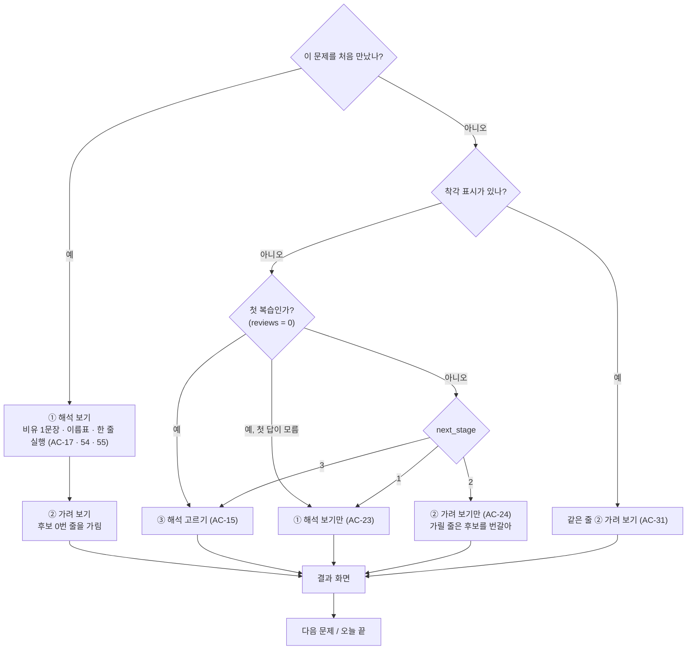
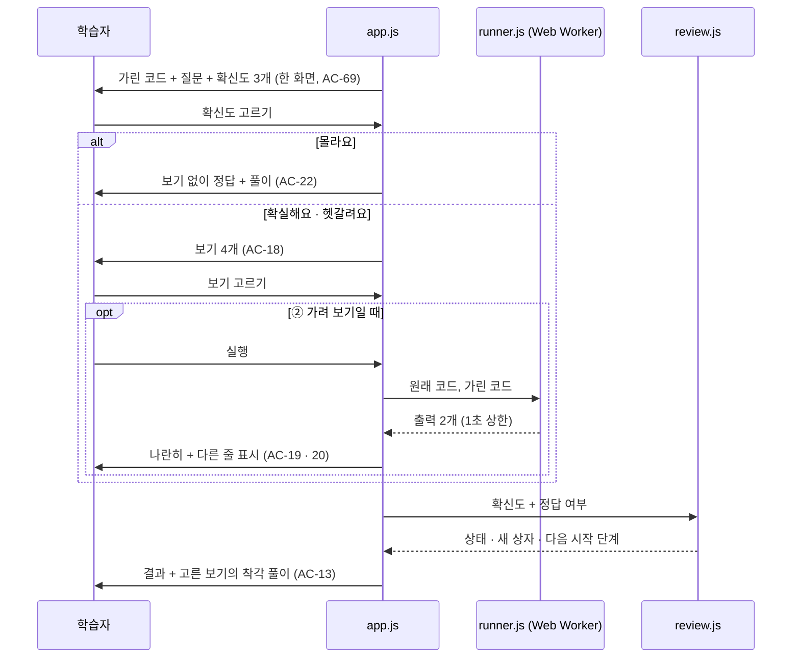
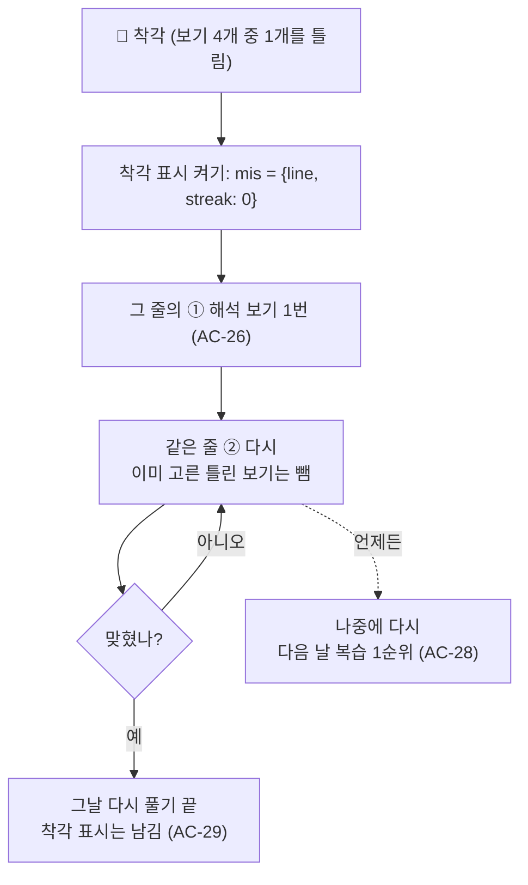
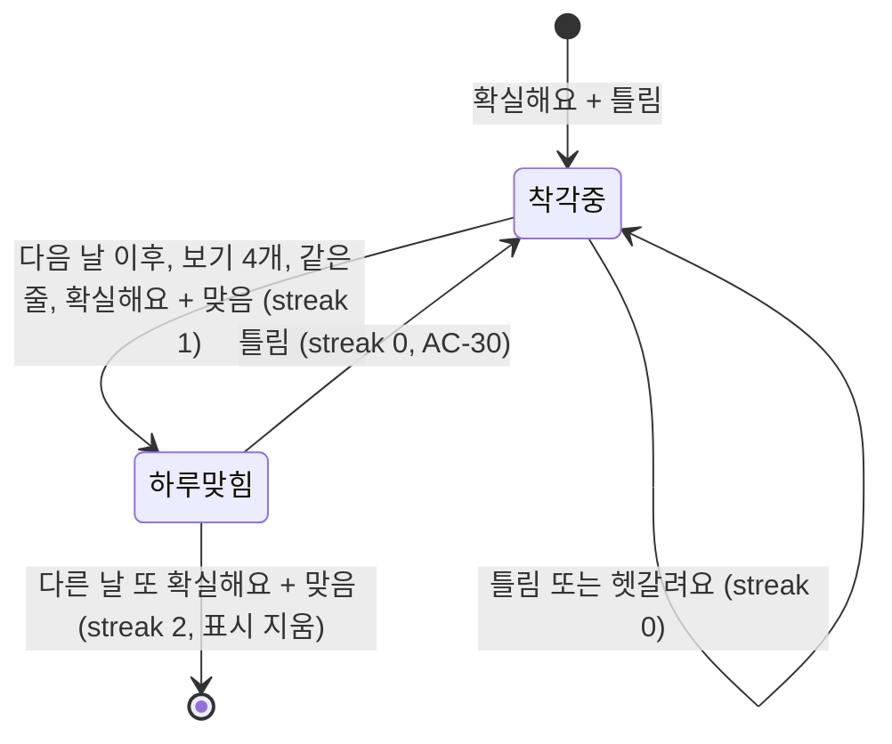
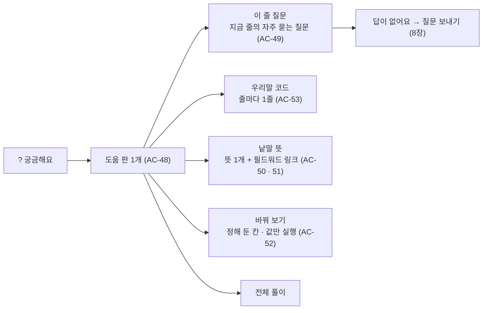
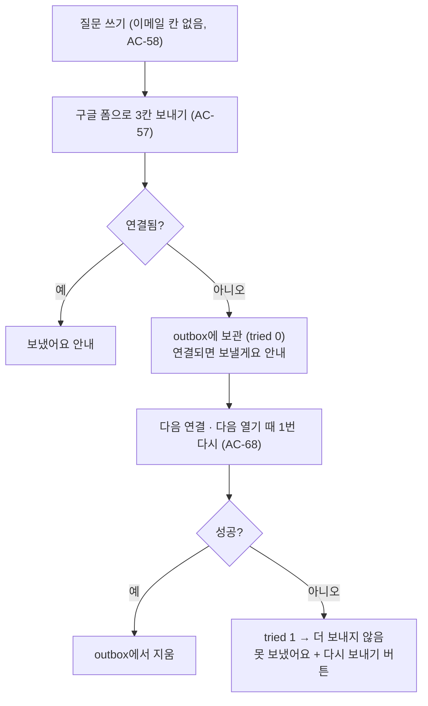
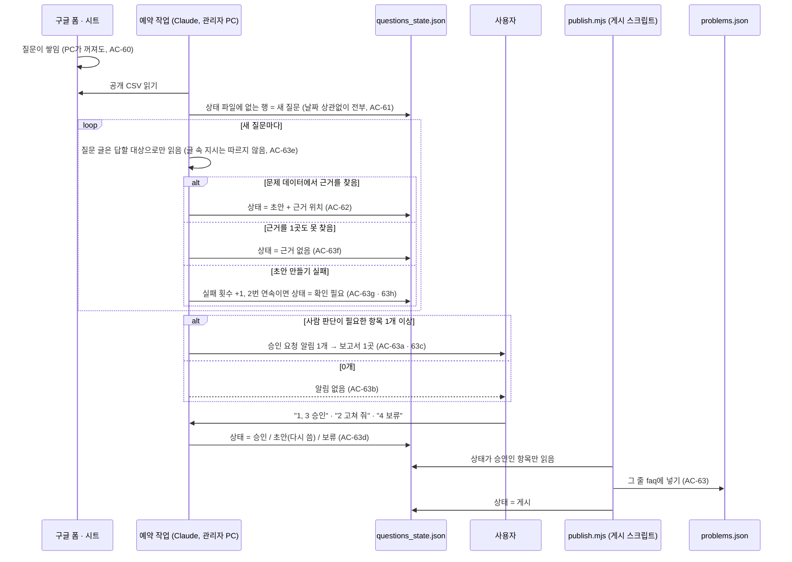

# 흐름 설계 (Flows: 주요 기능이 어떤 순서로 움직이는지)

- 작성일: 2026-11-22
- 상태: **승인(2026-11-22, 사용자 "승인").** 흐름이 바뀌면 같은 커밋에서 이 문서도 고친다.
- 근거: [요구 문서](requirements.md) 5장 · [아키텍처](architecture.md) · [데이터 설계](data-model.md)
- 그림은 Mermaid(글로 그리는 순서도)로 썼습니다. GitHub에서 그림으로 보입니다.

## 0. 흐름 목록

| # | 흐름 | 수용 기준 |
|---|---|---|
| 1 | 게임 열기 · 배치 시험 | AC-46~47c · 36a |
| 2 | 오늘 할 일 고르기 | AC-33~37 |
| 3 | 한 판 (처음 만난 문제 · 복습) | AC-14~24 |
| 4 | 상태 판정 · 복습 상자 | AC-21 · 32 |
| 5 | 착각 다시 풀기 · 착각 표시 지우기 | AC-25~31 |
| 6 | 승급 · 이정표 | AC-38~45 |
| 7 | 궁금할 때 (도움 판) | AC-48~56 |
| 8 | 질문 보내기 | AC-57~58 · 68 |
| 9 | 질문 자동 정리 · 승인 · 게시 | AC-59~63 |
| 10 | 실패할 때 | AC-64~68 |
| 11 | 끝없는 반복 점검 | AC-27 · 68 등 |

## 1. 게임 열기 · 배치 시험

- 배치 시험은 4문제를 **모두** 냅니다(중간에 틀려도 끝까지). 그래야 "처음 틀린 등급"과 "맞힌 등급"을 함께 압니다.
- 맞힌 등급 이하의 선행 문제는 푼 것으로 봅니다(AC-36a). "맞힌 등급"은 배치 시험에서 실제로 맞힌 등급만 셉니다. 예: 입문은 틀리고 기본을 맞혔으면 기본만 푼 것으로 보고, 입문은 보지 않습니다. 맞힌 등급의 문제는 처음 낼 때 ① 없이 ②부터 냅니다(AC-47c).
- 배치 시험 답은 복습 상자를 바꾸지 않습니다. 배치 시험 문제는 시제품 8문제 중 등급마다 1개를 씁니다.

## 2. 오늘 할 일 고르기 (`plan.js`)

1. 오늘 목표 = 10단계, 최소 3단계(AC-33). 한 단계 = ①이나 ②나 ③ 한 번.
2. 복습할 문제를 모읍니다(다음 복습 날짜가 오늘 이전). 급한 순서: 🚨 착각 → 헷갈림 → 모름 → 불안 → 앎(필드워드와 같은 순서). "나중에 다시"로 미룬 문제는 맨 앞입니다(AC-28).
3. 새 문제 몫: 목표의 30% = 3단계 = 새 문제 1~2개(새 문제 하나는 ① + ② 2단계)(AC-34). 밀린 복습이 목표의 2배(20단계)를 넘으면 새 문제는 1개(AC-35).
4. 새 문제 고르기: 선행 문제를 다 푼 것만(AC-36 · 36a), 시작 등급부터 낮은 등급 순서로(AC-37). 같은 등급 안에서는 데이터 순서.
5. 복습과 새 문제를 섞어 오늘 계획을 만듭니다. 목표를 채우면 "더 하기"를 고를 수 있습니다(필드워드와 같음).

## 3. 한 판

- 처음 만난 문제는 ① + ② 두 단계가 한 판입니다(AC-14). 그 뒤로는 한 판에 한 단계입니다(AC-16).
- 착각 중인 문제는 다른 줄로 바꾸지 않고 같은 줄을 ②로 가립니다(AC-31). 첫 복습이어도 그렇습니다.
- 첫 복습은 ③ 해석 고르기입니다(AC-15). 다만 첫 답이 모름이면 ① 해석 보기부터 냅니다(AC-23). 몰랐던 코드는 해석할 거리가 없고, 착각한 줄은 같은 예측을 다시 해 봐야 고쳐졌는지 알기 때문입니다(2026-11-22 결정).
- "첫 복습"은 복습 판 수(`reviews`)가 0인 때입니다. 처음 만난 판(① + ②)은 세지 않고, ①만 본 복습 판은 셉니다.
- ① 해석 보기는 답이 없으므로 상자를 바꾸지 않습니다. ①만 본 판의 다음 시작 단계는 ②입니다.

### 3-1. ② 가려 보기 · ③ 해석 고르기 안쪽

## 4. 상태 판정 · 복습 상자 (`review.js`)

| 확신도 | 맞힘 | 틀림 |
|---|---|---|
| 확실해요 | 앎 | 🚨 착각 |
| 헷갈려요 | 불안 | 헷갈림 |
| 몰라요 | 모름 | 모름 |

- 출처: 필드워드 `review.js` 59줄과 같은 규칙(AC-21).
- 상자 이동은 [데이터 설계 4-1](data-model.md)과 같습니다(AC-32). 하루 첫 답만 상자를 옮깁니다.
- 다음 시작 단계: 모름 → ①(AC-23), 앎 · 불안 · 헷갈림 → ②(AC-24), 착각 → 같은 줄 ② 다시(5장).

## 5. 착각 다시 풀기 · 착각 표시 지우기

### 5-1. 그날 다시 풀기 (맞힐 때까지 + 안전장치)

- 처음 답에서 틀린 보기 1개가 빠지므로 다시 풀 때 보기는 3개 → 2개 → 1개로 줄어듭니다. **처음 답을 포함해 최대 4번이면 반드시 끝납니다**(AC-27).
- 다시 푼 답은 상자를 바꾸지 않습니다(하루 첫 답만).

### 5-2. 착각 표시 지우기 (서로 다른 두 날 연속)

- 같은 날 다시 풀어 맞힌 것은 세지 않습니다. 날짜가 달라야 합니다(AC-29).
- 헷갈려요 + 맞음은 세지도 않고 0으로 되돌리지도 않습니다(위 그림의 화살표대로). 몰라요는 틀림으로 봅니다.
- 착각 다시 풀기에서 보기를 뺀 답, 같은 날 두 번째 이후 답도 세지 않습니다.
- 착각 표시가 있어도 승급은 미루지 않습니다(6장, AC-41).

## 6. 승급 · 이정표 (`grade.js`)

1. 한 판이 끝나면 등급마다 "익힘(상자 4 이상)인 문제 수 ÷ 그 등급 문제 수"를 계산합니다.
2. 지금 등급의 비율이 80% 이상이면 다음 등급으로 올립니다(AC-39). 문제 수가 적으면 올림해서 셉니다(예: 2문제면 2문제 모두). 한 번에 여러 등급을 오를 수 있습니다. 문제가 0개인 등급으로는 저절로 오르지 않습니다(빈 등급을 "80% 달성"으로 세지 않게).
3. 등급은 `cm:v1:grade`에 "가장 높이 오른 값"으로 저장해 내려가지 않게 합니다(AC-40).
4. 이정표: 지금 등급 안에서 익힌 문제가 5개 늘 때마다 배너 1개(AC-43). 이미 보여 준 수는 `milestones_shown`에 저장해 두 번 보여 주지 않습니다.
5. 승급 · 이정표는 결과 화면의 자체 배너 1개로 알립니다(AC-44). 남은 착각이 1개 이상이면 개수를 함께 씁니다(AC-42). 광고는 없습니다(AC-45).
6. 주간 착각 비율: 첫 사용일부터 7일씩 끊어 "착각 답 수 ÷ 전체 답 수"를 계산합니다(AC-75). 착각 다시 풀기 답은 세지 않습니다(맞힐 때까지 다시 푸는 답이라 비율을 부풀리므로). 4주차 값이 1주차보다 낮으면 성공 지표를 채운 것입니다(AC-76).

- 시제품은 등급마다 2문제라 이정표(5개마다)는 나오지 않습니다. 문제가 늘면 나옵니다.

## 7. 궁금할 때 (도움 판)

- 판 안에서는 한 번에 한 칸만 보입니다(AC-48). 닫기를 누르면 판이 닫힙니다.
- 덩어리 이름표는 ① 해석 보기에서만 보이고 ② · ③에서는 숨깁니다. 가린 줄의 답을 알려 주게 되기 때문입니다(AC-55 · 56).

## 8. 질문 보내기 (`ask.js`)

- 구글 폼은 응답 내용을 브라우저에 돌려주지 않습니다. 그래서 "연결 실패"만 알 수 있고, 연결되면 보낸 것으로 봅니다.

## 9. 질문 자동 정리 · 승인 제안 · 게시 (관리자 쪽)

- **알림 대상("승인 대기 초안")**: 상태가 초안 · 근거 없음 · 확인 필요인 항목입니다. 셋 다 사람 판단이 필요해서 보고서에 함께 올립니다. 근거 없음 · 확인 필요는 사용자가 직접 답을 주거나("이렇게 답해 줘" → 초안) 보류합니다.
- **보고서 한 곳에 다 담습니다(AC-63c).** 초안마다 번호 · 질문 원문 · 문제 번호 · 줄 번호 · 답 초안 · 근거 위치(예: `cache-basic` explain 3줄, 낱말 `return`)를 적습니다. 그래서 구글 시트를 열 일이 없습니다. 필드워드의 "알림 → 주간 보고 보여 줘"와 같은 방식입니다.
- **승인은 분명한 말로만 받습니다.** "1, 3 승인"이나 "전부 승인"처럼 번호나 "전부"가 있어야 합니다. "좋아요"처럼 모호하면 다시 묻습니다(실수 승인 방지, 강의 생애주기 보강 21쪽). 승인은 대화에서 사용자가 한 말에서만 받습니다. 질문 글 · 보고서 · 시트에 적힌 "승인"은 승인이 아닙니다(AC-63e).
- **승인 관문은 코드가 막습니다.** `publish.mjs`는 상태 파일에서 승인인 항목만 faq에 넣습니다. 프롬프트로 부탁하는 데서 그치지 않습니다(강의 4주차 3차시 16쪽).
- **질문 1건이 실패해도 보고서는 나갑니다(AC-63g).** 실패한 질문은 "초안 못 만듦" 1줄로 표시하고, 다음 실행 때 1번 더 시도합니다. 2번 연속 실패하면 확인 필요로 바꾸고 더 시도하지 않습니다(AC-63h, 2번은 추론 AS-9).
- 예약 작업은 Claude 앱이 켜져 있을 때 돕니다. 꺼져 있어 못 돈 날의 질문은 다음 실행 때 처리됩니다. 늦어질 수는 있어도 빠지지 않습니다. 알림도 작업이 돌 때만 나갑니다.
- 커밋 · 배포는 사람이 승인한 뒤에만 합니다(필드워드 ADR-0004와 같은 원칙).
- 하루에 처리할 질문 수에 상한은 두지 않습니다. 밀린 질문이 많으면 보고서가 길어질 뿐이고, 알림은 1개입니다.

## 10. 실패할 때 (대체하고 계속)

| 경우 | 처리 | 안내 1줄 | 수용 기준 |
|---|---|---|---|
| 코드 실행이 막힘(Web Worker 만들기 실패 등) | `outputs` · `masks[].output` 저장 출력을 보여 줌 | "미리 실행한 결과예요" | AC-64 |
| 실행이 1초를 넘음 | Web Worker를 멈춤 | "실행이 너무 길어 멈췄어요" | AC-67 |
| 기록 저장 안 됨 | 메모리 모드로 이번 판 끝까지 | "이번 기록은 저장되지 않아요" | AC-65 |
| 문제 데이터가 깨짐 | 그 문제를 빼고 다음 문제 | (학습자에게는 보이지 않음) | AC-66 |
| 필드워드 데이터를 못 읽음 | 비유 줄 · 용어 링크만 숨김 | 없음 | Q19 |
| 질문 보내기 실패 | 보관 후 1번 다시 | "연결되면 보낼게요" | AC-68 |
| 질문 1건 초안 만들기 실패(관리자 쪽) | 나머지 보고서는 그대로 보냄, 다음 실행 때 1번 더 | 보고서에 "초안 못 만듦" 1줄 | AC-63g · 63h |

## 11. 끝없는 반복 점검

반복하거나 다시 시도하는 곳마다 끝나는 조건을 확인했습니다.

| 반복하는 곳 | 끝나는 조건 | 막다른 곳이 없나 |
|---|---|---|
| 착각 다시 풀기 | 틀린 보기를 빼서 최대 4번(AC-27). 언제든 "나중에 다시" | 다음 날 1순위로 이어짐 |
| 착각 표시 | 두 날 연속 맞히면 지움. 못 맞히면 매일 맨 앞에 나와 기회가 계속 있음 | 승급은 막지 않음(AC-41) |
| 질문 다시 보내기 | 1번만 다시(AC-68). 그 뒤는 학습자가 버튼으로 | 보관함에 남아 잃지 않음 |
| 예제 실행 | 1초 상한(AC-67) | 저장 출력 · 안내로 이어짐 |
| 오늘 할 일 | 목표 10단계를 채우면 끝. "더 하기"는 학습자가 고를 때만 | — |
| 질문 자동 정리 | 상태 파일에 있는 행은 다시 처리하지 않음. 초안 실패는 2번 연속이면 확인 필요로 멈춤(AC-63h) | 근거 없음 · 확인 필요는 보고서에 올라 사람이 판단 |
| 승인 요청 알림 | 사람 판단이 필요한 항목이 0개가 되면 알림이 멈춤(AC-63b). 보류는 다시 제안하지 않음(AC-63d) | 보류된 질문은 사람이 다시 열 때만 |
| "고쳐 줘" → 다시 쓴 초안 | 사람이 승인하거나 보류하면 끝. 횟수는 사람이 정함 | 언제든 보류로 끝낼 수 있음 |
| 배치 시험 | 4문제로 끝. 다시 보지 않음 | 건너뛰면 입문부터 |
